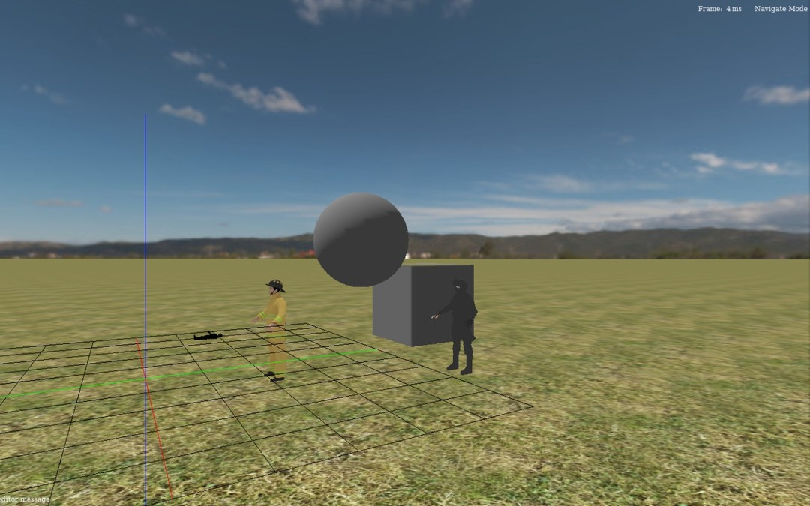

# Pavon Engine
Game Engine for GNU/Linux


Pengine builds as a static library, `lib/libpengine.a`. Games link against it and
provide their own `main()`; see `demos/chess`.

Vulkan is the only renderer. The engine draws models and owns the window, the
camera, memory and input — it does not own your scene.

What it has to build a game with:
- glTF models, including models of several materials drawn with physically
  based shading (metal and roughness, normal maps) lit by a high dynamic range
  panorama, which is also its sky
- skinned and animated models
- a raycast vehicle for cars
- terrain, buildings and water streamed from World of Warcraft Classic tiles
- text and interface quads

## Dependencies
- make
- gcc
- glslc
- vulkan
- wayland, xkbcommon, EGL
- [cglm](https://github.com/recp/cglm) (headers only, fetched by `./configure` when the host has none)
- [lodepng](https://github.com/lvandeve/lodepng)
- [pway](https://github.com/oscar0pavon/pway)
- curl, to fetch the single-file libraries below

`./configure` downloads [stb_image](https://github.com/nothings/stb),
[parson](https://github.com/kgabis/parson) and
[cgltf](https://github.com/jkuhlmann/cgltf) into `src/external`, each at a
pinned commit and checked against its sha256. `make` runs it when they are
missing.

EGL is on the link line for pway's sake, not the engine's; nothing here draws
with GL.

pway is looked for under `/usr/local`; the build adds `-I/usr/local/include`
and `-I src/external` (where `./configure` puts cglm if the host has none),
and nothing else beyond the default paths.

## Build
```
git clone https://github.com/oscar0pavon/pengine
cd pengine
make -j8
```

This builds `lib/libpengine.a` and compiles the SPIR-V shaders in `src/shaders`.

`make install` puts the headers in `/usr/local/include/pengine` and the library in
`/usr/local/lib`. A program that installs them adds `-I/usr/local/include/pengine`
and nothing else, because the headers keep the tree they are written against.

## Run the chess demo
```
make -C demos/chess
cd demos/chess
./pchess
```
It loads its models by relative path, so run it from its own directory.

## Write a game
Fill a `PGame` with your callbacks and hand it to `pengine_run()`. The engine
opens a Wayland window; set `is_drm_rendering = true` first to drive KMS
itself instead.

Drawing goes through `pe_vk_draw_scene`. The render pass calls that hook from
inside the pass, and what it records is your scene — the engine has none of its
own to walk.

```c
#include <engine/engine.h>
#include <engine/files.h>
#include <engine/renderer/descriptor_set.h>
#include <engine/renderer/draw.h>
#include <engine/renderer/shaders.h>
#include <engine/renderer/uniform_buffer.h>

static PModel cube;
static PShader shader;

static void game_draw_scene(VkCommandBuffer *cmd_buffer, uint32_t index) {

  PUniformBufferObject *ubo = &cube.uniform_buffer_object;

  glm_mat4_copy(cube.model_mat, ubo->model);
  glm_mat4_copy(main_camera.view, ubo->view);
  glm_mat4_copy(main_camera.projection, ubo->projection);
  glm_vec4_copy(VEC4(1, 0.4f, 0, 1), ubo->color);

  pe_vk_send_uniform_buffer(&cube, index);

  PDrawModelCommand draw;
  ZERO(draw);
  draw.model = &cube;
  draw.layout = pe_vk_pipeline_layout_with_descriptors;
  draw.command_buffer = *cmd_buffer;
  draw.image_index = index;

  pe_vk_draw_model(&draw);
}

void game_init() {

  camera_init(&main_camera);
  init_vec3(-5, 0, 0, main_camera.position);
  camera_update(&main_camera);

  PCreateShaderInfo shader_info;
  ZERO(shader_info);
  shader_info.out_shader = &shader;
  shader_info.vertex_path = file_color_vert_spv;
  shader_info.fragment_path = file_color_frag_spv;
  shader_info.layout = pe_vk_pipeline_layout_with_descriptors;

  pe_vk_create_shader(&shader_info);

  pe_vk_load_model(&cube, "cube.glb");
  cube.shader = shader;

  pe_model_transform(&cube, VEC3(0, 0, 0), 0, VEC3(1, 0, 0), VEC3(1, 1, 1));

  pe_vk_draw_scene = &game_draw_scene;
}

void game_update() {}
void game_draw() {}
void game_input() {}

int main() {
  PGame game;
  ZERO(game);
  game.init = &game_init;
  game.update = &game_update;
  game.draw = &game_draw;
  game.input = &game_input;

  pengine_run(&game);
  return 0;
}
```

`game_init()` runs after the renderer is up, so it can already count on a
device, a swap chain and the pipeline layouts.

Compile it with the same defines and flags the engine uses — the projection
matrices depend on them — which `include.make` already carries:

```make
WORKDIR := <path to pengine>

include <path to pengine>/include.make

game: game.c
	$(CC) $(CFLAGS) $(GLOBAL_DEFINE) $(CINCLUDES) game.c \
		-L$(WORKDIR)/lib -lpengine $(LIBRARIES) -o game
```

## Models

`pe_vk_load_model()` reads a glTF file and gives the model everything it needs
to be drawn: vertex and index buffers, uniform buffers, and the descriptor sets
`pe_vk_draw_model()` binds each frame.

To put the same geometry on screen more than once, use `pe_vk_model_instance()`.
It shares the source's vertex and index buffers but gives the copy its own
uniform buffers and descriptor sets, because those are what carry a model's
transform — sharing them would make every copy sit wherever the last one moved.

A model keeps its own transform in `PModel.model_mat`:

```c
pe_model_transform(&model, VEC3(x, y, z), 90, VEC3(1, 0, 0), VEC3(s, s, s));
pe_model_set_position(&model, VEC3(x, y, z));
pe_model_translate(&model, VEC3(0, 0, 1));
pe_model_rotate(&model, 45, VEC3(0, 0, 1));
pe_model_scale(&model, VEC3(2, 2, 2));
pe_model_transform_reset(&model);
```

`pe_model_transform()` composes translate * rotate * scale and replaces whatever
was there; angles are in degrees. `pe_model_set_position()` replaces only the
translation, leaving rotation and scale alone.

## Input

Keys are raw evdev codes, reported by pway and matched in `pe_parse_key_event()`:

```c
void game_input() {
  if (key_released(&input.Q))
    exit(0);
}
```

`docs/` has more: `editor_commands.txt` and `editor_man.txt` on the editor,
`android` and `compile` on the Android build. `code.txt` describes an older
Element/Component frame flow that the engine no longer has.
